# HomeMind 🧠🏡
**Context-Aware Multi-Device AI Home Agent**  
*Built for the Amazon Build, Ship, Shape Hackathon*

[](tests/)
[](frontend/)
[](backend/mcp/)
[](backend/)
[](frontend/)

---

## 1. Problem Statement & Target Users

### The Problem
Contemporary smart homes suffer from severe **notification fatigue** and **lack of situational awareness**. 

Today, smart home devices operate as fragmented, isolated silos. A backyard camera, front porch doorbell, or hallway motion sensor triggers indiscriminately. When a user is in a deep work focus block or asleep, a fluttering tree branch or routine pet movement fires the exact same intrusive chime as an urgent perimeter breach. 

Existing solutions merely bridge APIs with naive "if-this-then-that" scripts. They cannot evaluate:
- Is anyone actually home?
- What are household members doing right now?
- Has the user explicitly asked to monitor a specific area for a short window?
- Is this event worth interrupting the user, or should it be quietly logged?

### Target Users
- **Busy Professionals & Remote Workers**: Who need protection from distraction during meetings and focus sessions without missing critical deliveries or safety alerts.
- **Families & Homeowners**: Who desire unified ambient home awareness without navigating multiple siloed device apps.
- **Ambient Computing Enthusiasts**: Who want conversational interfaces (Alexa+) and ambient visual displays (Fire TV) to act as a cohesive household intelligence.

---

## 2. HomeMind's Core Differentiator

The core differentiator of HomeMind is **cognitive decision intelligence**, NOT simple API piping.

HomeMind maintains an evolving, unified world model of the home (`HomeState`) and processes all sensor and command inputs through a **5-step cognitive pipeline**:

1. **What happened?** (Contextual event classification and debouncing)
2. **Whether it matters?** (Significance filtering against active watches, modes, and history)
3. **Whether the user should be interrupted?** (Attention management matching occupancy modes: `home`, `away`, `sleep`, `focus`)
4. **What information or action is appropriate?** (Action synthesis)
5. **Which device should communicate it?** (Cross-device multimodal routing: spoken voice via Alexa vs. subtle visual banners via Fire TV vs. silent memory log)

### Ecosystem Roles

| Component | Role in HomeMind |
| :--- | :--- |
| **Ring** | Perception layer: Real-world physical events (doorbell dings, perimeter motion, contact sensors). |
| **Alexa / Alexa+** | Conversational voice interface: Natural language commands, proactive voice alerts, and MCP tool execution. |
| **Fire TV** | Ambient visual interface: Picture-in-picture camera overlays, context cards, and quiet notifications. |
| **HomeMind** | Central intelligence: `ContextManager`, `MemoryManager`, `DecisionEngine`, `AgentPlanner`, and `MCP Server`. |
| **AWS** | Cloud-native deployment target: Compute (App Runner / ECS), persistence (DynamoDB), and reasoning (Bedrock). |

---

## 3. System Architecture & Event Flow

```mermaid
flowchart TD
    %% User Interfaces
    subgraph UI ["User & Ambient Interfaces"]
        FE["React / Vite Control Center\n(Port 5173)"]
        ChatUI["Alexa+ Conversational Panel"]
        SimControls["Simulation Controls\n(Doorbell, Motion, Modes)"]
    end

    %% Ingestion & API Layer
    subgraph API ["FastAPI Service Layer (Port 8081)"]
        RouterState["GET /state, /watches, /alerts, /events"]
        RouterSim["POST /simulate/event"]
        RouterChat["POST /chat"]
        RouterMode["POST /mode, /commands"]
        HealthEndpoint["GET /health"]
    end

    %% MCP Layer
    subgraph MCPLayer ["HomeMind MCP Server & Tools"]
        MCPServer["MCPServer (Streamable HTTP / STDIO)"]
        ToolStatus["get_home_status()"]
        ToolWhat["what_happened(location, since_minutes)"]
        ToolMode["set_home_mode(mode)"]
        ToolWatch["set_temporary_watch(location, duration)"]
        ToolEvents["get_recent_events(limit)"]
        ToolClear["clear_alert(alert_id)"]
    end

    %% Cognitive Engine
    subgraph Brain ["HomeMind Cognitive Core"]
        Planner["AgentPlanner (Orchestrator)"]
        ContextMgr["ContextManager (HomeState & Modes)"]
        MemoryMgr["MemoryManager (History & Watches)"]
        DecisionEng["DecisionEngine (5-Step Evaluation)"]
    end

    %% Multimodal Output Adapters
    subgraph OutputAdapters ["Multimodal Provider Adapters (backend/integrations)"]
        AlexaAdp["AlexaAdapter (Voice announcements)"]
        FireTVAdp["FireTVAdapter (Visual overlays)"]
        RingAdp["RingAdapter (Event listener)"]
    end

    %% Planned Integrations (Dashed)
    subgraph PlannedCloud ["Planned Production Integrations (Post-Hackathon)"]
        LiveAlexa["Alexa+ Cloud Agent Skills (Streamable HTTP)"]
        LiveRing["Ring OAuth Webhook Ingestion"]
        LiveFireTV["Fire TV WebSocket Client"]
        LiveAWS["AWS ECS, DynamoDB, Bedrock"]
    end

    %% Connections
    FE --> RouterState
    ChatUI --> RouterChat
    SimControls --> RouterSim
    SimControls --> RouterMode

    RouterChat --> MCPServer
    MCPServer --> ToolStatus
    MCPServer --> ToolWhat
    MCPServer --> ToolMode
    MCPServer --> ToolWatch
    MCPServer --> ToolEvents
    MCPServer --> ToolClear

    ToolStatus --> Planner
    ToolWhat --> Planner
    ToolMode --> Planner
    ToolWatch --> Planner
    ToolEvents --> Planner
    ToolClear --> Planner

    RouterSim --> Planner
    RouterMode --> Planner
    RouterState --> Planner

    Planner --> ContextMgr
    Planner --> MemoryMgr
    Planner --> DecisionEng
    DecisionEng -.->|Query State| ContextMgr
    DecisionEng -.->|Query Watches| MemoryMgr

    DecisionEng -->|AgentAction| OutputAdapters
    AlexaAdp -.->|Voice Response| ChatUI
    FireTVAdp -.->|Visual Card| FE

    LiveAlexa -.->|HTTP MCP Call| MCPServer
    LiveRing -.->|Webhook Payload| RouterSim
    FireTVAdp -.->|Push Card| LiveFireTV
    Planner -.->|Persistent State| LiveAWS

    style UI fill:#1e293b,stroke:#3b82f6,stroke-width:2px,color:#f8fafc
    style API fill:#0f172a,stroke:#10b981,stroke-width:2px,color:#f8fafc
    style MCPLayer fill:#1e1e38,stroke:#8b5cf6,stroke-width:2px,color:#f8fafc
    style Brain fill:#1a202c,stroke:#f59e0b,stroke-width:3px,color:#f8fafc
    style OutputAdapters fill:#14221d,stroke:#06b6d4,stroke-width:2px,color:#f8fafc
    style PlannedCloud fill:#2d1b2d,stroke:#ec4899,stroke-width:2px,stroke-dasharray: 5 5,color:#fbcfe8
```



---

## 4. Features Currently Implemented

- ✅ **Operational FastAPI Backend**: Running on port **8081** with routes for health inspection, event ingestion, state queries, watch management, and conversational simulation.
- ✅ **Dynamic ContextManager**: Tracks dynamic `HomeState`, device registry, active alerts, context summaries, and occupancy modes (`home`, `away`, `sleep`, `focus`).
- ✅ **MemoryManager & Temporary Watches**: Maintains a rolling short-term event memory and manages user-initiated temporary watch intentions (e.g. *"Watch the front door for 30 minutes"*), with automatic UTC expiration and cancellation.
- ✅ **5-Step DecisionEngine**: Classifies events into `IGNORE`, `UPDATE_CONTEXT_ONLY`, `NOTIFY_USER`, or `TRIGGER_ACTION`, evaluating active watches, duplicate debounce thresholds, and occupancy modes to route output multimodally.
- ✅ **Model Context Protocol (MCP) Server**: 6 standards-compliant tools registered via the MCP Python SDK, enabling external AI agents like Alexa+ to interact with home state.
- ✅ **Deterministic Simulator Agent**: Translates natural-language user utterances into typed MCP tool invocations without requiring an external paid LLM for local evaluation.
- ✅ **React/Vite Control Center Dashboard**: Modern dark-themed single-page app on port **5173** featuring:
  - Real-time connection badge verifying port 8081 backend connectivity.
  - Ambient home state metrics (occupancy mode, alert count, active watches).
  - Active watch cards with live remaining time calculation and one-click cancellation.
  - Active alert banner with instant dismissal.
  - Recent event timeline.
  - Interactive Alexa+ conversation interface.
  - Quick simulation trigger controls (Doorbell, Motion, Vehicle, Mode toggles).
- ✅ **Automated Test Suite**: 28 unit and integration tests passing with 100% success rate.

---

## 5. Technology Stack

- **Backend**: Python 3.11+, [FastAPI](https://fastapi.tiangolo.com/), [Pydantic v2](https://docs.pydantic.dev/), [Uvicorn](https://www.uvicorn.org/)
- **Model Context Protocol**: Official `mcp` Python SDK
- **Frontend**: [React 18](https://react.dev/), [Vite](https://vitejs.dev/), [Lucide React](https://lucide.dev/) (icons)
- **Testing**: [Pytest](https://docs.pytest.org/), [HTTPX](https://www.python-httpx.org/) (FastAPI TestClient), AnyIO
- **Operating Environment**: Verified and optimized on Windows 11 PowerShell

---

## 6. Available MCP Tools & Simulator Usage

HomeMind exposes 6 tools designed for Model Context Protocol clients (such as Alexa+ Agent Skills):

| Tool Name | Parameters | Description | Example Spoken Response |
| :--- | :--- | :--- | :--- |
| `get_home_status` | *None* | Returns current occupancy mode, active alerts, device inventory count, and context summary. | *"Home is currently in 'focus' mode with 2 known device(s). No active alerts."* |
| `what_happened` | `location` (opt), `since_minutes` (opt) | Summarizes recent events from memory with optional location and time filters. | *"Found 2 event(s) for front_door: doorbell_press at front_door, motion_detected at front_door."* |
| `set_home_mode` | `mode` (`home`\|`away`\|`sleep`\|`focus`) | Updates the active occupancy mode and recalculates attention thresholds. | *"Occupancy mode successfully changed from 'home' to 'focus'."* |
| `set_temporary_watch` | `location`, `duration_minutes`, `event_types` (opt) | Creates a temporary monitoring intention in memory with automatic expiration. | *"Temporary watch established on front_door for all activities. Active for 30 minute(s)..."* |
| `get_recent_events` | `limit` (default: 10) | Returns structured raw event payloads from operational memory. | *"Retrieved 4 recent event(s) from memory."* |
| `clear_alert` | `alert_id` (string or 'all') | Clears an active alert by ID or keyword match. | *"Alert 'doorbell_press' has been cleared."* |

### Simulator Conversational Patterns

The built-in `SimulatedAlexaAgent` (`backend/simulator/agent.py`) maps natural utterances to MCP tools:
- *"Watch the front door for 30 minutes"* $\rightarrow$ `set_temporary_watch(location='front_door', duration_minutes=30)`
- *"What happened at the front door?"* $\rightarrow$ `what_happened(location='front_door')`
- *"What happened at home?"* $\rightarrow$ `what_happened()`
- *"Set mode to focus"* $\rightarrow$ `set_home_mode(mode='focus')`
- *"Clear alert doorbell"* $\rightarrow$ `clear_alert(alert_id='doorbell')`
- *"What is happening at home?"* $\rightarrow$ `get_home_status()`

---

## 7. Setup & Run Instructions (Windows PowerShell)

### Prerequisites
- Python 3.11+
- Node.js 18+ and npm
- Windows PowerShell

### Step 1: Clone & Set Up Python Environment

```powershell
# Navigate to the repository
cd C:\Users\sethi\HomeMind

# Create virtual environment (if not already present)
python -m venv .venv

# Activate the virtual environment
.\.venv\Scripts\Activate.ps1

# Install backend dependencies
pip install -r requirements.txt
```

### Step 2: Set Up Frontend Dependencies

```powershell
cd frontend
npm install
cd ..
```

### Step 3: Run the Backend (Port 8081)

Open a PowerShell terminal:

```powershell
.\.venv\Scripts\Activate.ps1
python -m uvicorn backend.main:app --port 8081 --reload
```

Verify backend health in another terminal or browser:
```powershell
curl http://127.0.0.1:8081/health
# Response: {"status":"ok","service":"homemind"}
```

Interactive OpenAPI documentation is available at `http://127.0.0.1:8081/docs`.

### Step 4: Run the Frontend (Port 5173)

Open a separate PowerShell terminal:

```powershell
cd frontend
npm run dev
```

Open your browser at **`http://localhost:5173`**. The control center will connect to the backend on port 8081 via the configured Vite reverse proxy, displaying **"● Backend Online (Port 8081)"**.

---

## 8. Testing Instructions & Verified Results

### Backend Automated Test Suite
Run the 28 automated tests covering agents, API routes, health, MCP tools, and watches:

```powershell
.\.venv\Scripts\Activate.ps1
python -m pytest -v
```

**Verified Test Output**:
```text
============================= test session starts =============================
platform win32 -- Python 3.11.9, pytest-9.1.1, pluggy-1.6.0
rootdir: C:\Users\sethi\HomeMind
plugins: anyio-4.15.1
collected 28 items

tests\test_agent.py .....                                                [ 17%]
tests\test_commands.py ..                                                [ 25%]
tests\test_events.py ...                                                 [ 35%]
tests\test_health.py ..                                                  [ 42%]
tests\test_mcp.py .......                                                [ 67%]
tests\test_simulator_api.py ....                                         [ 82%]
tests\test_watch.py .....                                                [100%]

============================= 28 passed in 4.73s ==============================
```

### Frontend Production Build
Verify that the React/Vite single-page application builds cleanly for production:

```powershell
cd frontend
npm run build
```

**Verified Build Output**:
```text
vite v5.4.21 building for production...
transforming...
✓ 1592 modules transformed.
rendering chunks...
computing gzip size...
dist/index.html                   1.03 kB │ gzip:  0.61 kB
dist/assets/index-D0tRDQsT.css    3.18 kB │ gzip:  1.30 kB
dist/assets/index-Bp3bsZom.js   171.20 kB │ gzip: 53.14 kB
✓ built in 7.24s
```

---

## 9. Honest Limitations & Scope Boundaries

In accordance with strict hackathon integrity, we explicitly document current system boundaries:

1. **Simulated Ring Events**: Real-world events (doorbell dings, motion detection, vehicle arrival) are currently injected through the simulator API endpoints (`POST /simulate/event` or `POST /events`), not live Ring cloud OAuth webhooks.
2. **Local In-Memory State**: State and rolling event memory are stored in high-performance memory structures (`ContextManager` & `MemoryManager`). Persistent Amazon DynamoDB storage is designed in the architecture but not yet provisioned.
3. **Alexa-Style MCP Client Simulation**: The conversation panel and deterministic simulator agent model how Alexa+ with Agent Skills will invoke MCP tools; it is not yet connected to a live Alexa+ cloud developer account.
4. **Physical Device Dispatch**: The integration adapters (`AlexaAdapter`, `FireTVAdapter`, `RingAdapter` in `backend/integrations/`) define abstract contracts and log simulated dispatches. Physical hardware drivers are not connected.
5. **Deterministic Reasoning**: The current local planner relies on deterministic cognitive rules rather than external LLM calls (e.g. Amazon Bedrock), ensuring predictable, offline-executable, reproducible evaluation.

---

## 10. Repository Structure

```
HomeMind/
├── backend/
│   ├── main.py                  # FastAPI application entry point (Port 8081)
│   ├── agent/
│   │   ├── context.py           # ContextManager: tracks HomeState & occupancy modes
│   │   ├── memory.py            # MemoryManager: short-term rolling history & watches
│   │   ├── decisions.py         # DecisionEngine: 5-step cognitive pipeline
│   │   └── planner.py           # AgentPlanner: master orchestration
│   ├── api/
│   │   ├── health.py            # Health check endpoint (GET /health)
│   │   ├── events.py            # Event ingestion endpoints (POST /events)
│   │   ├── commands.py          # Command handling endpoints (POST /commands)
│   │   ├── simulator.py         # Frontend state, watches, alerts, chat, and simulation
│   │   └── deps.py              # Dependency injection for AgentPlanner
│   ├── models/
│   │   ├── events.py            # Pydantic schemas: HomeEvent, UserCommand
│   │   ├── home_state.py        # Pydantic schemas: HomeState, TemporaryWatch
│   │   └── actions.py           # Pydantic schemas: AgentAction, DecisionType
│   ├── mcp/
│   │   ├── server.py            # Standards-compliant Model Context Protocol server
│   │   ├── tools.py             # Implementation of 6 MCP tools
│   │   └── schemas.py           # Pydantic schemas for MCP tool inputs/outputs
│   ├── simulator/
│   │   ├── agent.py             # SimulatedAlexaAgent: regex-to-MCP natural language agent
│   │   └── events.py            # Simulated event factories (doorbell, motion)
│   └── integrations/
│       ├── base.py              # BaseIntegration abstract provider interface
│       ├── ring.py              # Ring placeholder adapter
│       ├── alexa.py             # Alexa placeholder adapter
│       └── firetv.py            # Fire TV placeholder adapter
├── frontend/
│   ├── src/
│   │   ├── App.jsx              # Main Control Center UI with real-time state & chat
│   │   ├── main.jsx             # React entry point
│   │   └── index.css            # Dark theme styles & responsive layout
│   ├── vite.config.js           # Vite config with reverse proxy to port 8081
│   └── package.json             # React 18, Vite, and Lucide React dependencies
├── tests/
│   ├── test_health.py           # Health endpoint tests
│   ├── test_events.py           # Event ingestion & state update tests
│   ├── test_commands.py         # Command handling & mode switching tests
│   ├── test_agent.py            # DecisionEngine & ContextManager unit tests
│   ├── test_mcp.py              # MCP server and tool execution tests
│   ├── test_watch.py            # TemporaryWatch lifecycle and expiration tests
│   └── test_simulator_api.py    # Simulator REST endpoints & chat tests
├── docs/
│   ├── architecture.md          # In-depth architectural specification & Mermaid diagram
│   ├── SUBMISSION.md            # Submission form text, 2-minute video demo script, screenshot checklist
│   └── AMAZON_CAPABILITY_AUDIT.md # Technical feasibility report for Alexa+, Ring, Fire TV, and AWS
├── requirements.txt             # Python dependencies
└── .gitignore                   # Configured for Python, Node, Vite, secrets, and Windows
```

---

## 11. Submission Kit & References

- **Architecture Guide**: [docs/architecture.md](docs/architecture.md)
- **Submission Form & Demo Script**: [docs/SUBMISSION.md](docs/SUBMISSION.md)
- **Amazon Ecosystem Feasibility Audit**: [docs/AMAZON_CAPABILITY_AUDIT.md](docs/AMAZON_CAPABILITY_AUDIT.md)
