# HomeMind Architecture & Technical Specification

> **Submission Note**: Built for the Amazon Build, Ship, Shape Hackathon.
> Current status: Working end-to-end local agentic architecture with MCP layer and React/Vite control center.

---

## 1. System Overview

**HomeMind** is an intelligent context, memory, and decision layer for the ambient smart home.

Rather than treating smart home devices as isolated triggers (e.g., "if motion, turn on light"), HomeMind models the home as an evolving context. It ingests physical events, tracks who is home and what they are doing, and continuously evaluates:
1. **What happened?** (Contextual event classification)
2. **Whether it matters?** (Significance filtering against active watches and modes)
3. **Whether the user should be interrupted?** (Attention management based on mode)
4. **What information or action is appropriate?** (Action synthesis)
5. **Which device should communicate it?** (Cross-device multimodal routing: spoken voice vs. visual screen vs. silent context update)

---

## 2. Complete Architecture Diagram

The diagram below illustrates the active local implementation alongside planned cloud and hardware integrations:

```mermaid
flowchart TD
    %% Subgraph: User Interfaces
    subgraph UI ["User & Ambient Interfaces"]
        FE["React / Vite Control Center\n(Port 5173 / Localhost)"]
        ChatUI["Alexa+ Conversational Panel\n(Voice Utterance Simulation)"]
        SimControls["Simulation Controls\n(Doorbell, Motion, Vehicle, Mode)"]
    end

    %% Subgraph: Ingestion & API Layer
    subgraph API ["FastAPI Ingestion & Service Layer (Port 8081)"]
        RouterState["GET /state, /watches, /alerts, /events"]
        RouterSim["POST /simulate/event"]
        RouterChat["POST /chat"]
        RouterMode["POST /mode, /commands"]
        HealthEndpoint["GET /health"]
    end

    %% Subgraph: MCP Layer
    subgraph MCPLayer ["HomeMind MCP Server & Tools"]
        MCPServer["MCPServer (Streamable HTTP / STDIO)"]
        ToolStatus["get_home_status()"]
        ToolWhat["what_happened(location, since_minutes)"]
        ToolMode["set_home_mode(mode)"]
        ToolWatch["set_temporary_watch(location, duration)"]
        ToolEvents["get_recent_events(limit)"]
        ToolClear["clear_alert(alert_id)"]
    end

    %% Subgraph: Core Cognitive Engine
    subgraph Brain ["HomeMind Cognitive Core"]
        Planner["AgentPlanner\n(Orchestration Engine)"]
        ContextMgr["ContextManager\n(HomeState, Modes, Alerts, Devices)"]
        MemoryMgr["MemoryManager\n(Rolling Events, Temporary Watches)"]
        DecisionEng["DecisionEngine\n(5-Step Cognitive Pipeline)"]
    end

    %% Subgraph: Multimodal Output Layer
    subgraph OutputAdapters ["Multimodal Provider Adapters (backend/integrations)"]
        AlexaAdp["AlexaAdapter\n(Voice announcements / Chimes)"]
        FireTVAdp["FireTVAdapter\n(PiP feeds / Context cards)"]
        RingAdp["RingAdapter\n(Event listener interface)"]
    end

    %% Subgraph: Planned Cloud Integrations (Dashed)
    subgraph PlannedCloud ["Planned Production Integrations (Post-Hackathon)"]
        LiveAlexa["Alexa+ Cloud Agent Skills\n(External Streamable HTTP MCP)"]
        LiveRing["Ring OAuth Webhook Pipeline\n(Live Video & Ding Webhooks)"]
        LiveFireTV["Fire TV App / Web Wrapper\n(WebSocket Display Client)"]
        LiveAWS["AWS Backend Infrastructure\n(ECS Fargate, DynamoDB, Bedrock)"]
    end

    %% Data Flow Connections - UI to API
    FE --> RouterState
    ChatUI --> RouterChat
    SimControls --> RouterSim
    SimControls --> RouterMode

    %% API to MCP / Cognitive Core
    RouterChat --> MCPServer
    MCPServer --> ToolStatus
    MCPServer --> ToolWhat
    MCPServer --> ToolMode
    MCPServer --> ToolWatch
    MCPServer --> ToolEvents
    MCPServer --> ToolClear

    ToolStatus --> Planner
    ToolWhat --> Planner
    ToolMode --> Planner
    ToolWatch --> Planner
    ToolEvents --> Planner
    ToolClear --> Planner

    RouterSim --> Planner
    RouterMode --> Planner
    RouterState --> Planner

    %% Cognitive Core Interconnections
    Planner --> ContextMgr
    Planner --> MemoryMgr
    Planner --> DecisionEng
    DecisionEng -.->|Query Context & Watches| ContextMgr
    DecisionEng -.->|Query History| MemoryMgr

    %% Decision Output to Adapters
    DecisionEng -->|AgentAction: notify_user / trigger_action| OutputAdapters
    AlexaAdp -.->|Spoken Alert| ChatUI
    FireTVAdp -.->|Visual Notification| FE

    %% Planned Integrations Links (Dotted)
    LiveAlexa -.->|HTTP MCP Call| MCPServer
    LiveRing -.->|Webhook Payload| RouterSim
    FireTVAdp -.->|Visual Render| LiveFireTV
    Planner -.->|Persistent State & LLM| LiveAWS

    %% Styling
    style UI fill:#1e293b,stroke:#3b82f6,stroke-width:2px,color:#f8fafc
    style API fill:#0f172a,stroke:#10b981,stroke-width:2px,color:#f8fafc
    style MCPLayer fill:#1e1e38,stroke:#8b5cf6,stroke-width:2px,color:#f8fafc
    style Brain fill:#1a202c,stroke:#f59e0b,stroke-width:3px,color:#f8fafc
    style OutputAdapters fill:#14221d,stroke:#06b6d4,stroke-width:2px,color:#f8fafc
    style PlannedCloud fill:#2d1b2d,stroke:#ec4899,stroke-width:2px,stroke-dasharray: 5 5,color:#fbcfe8
```



---

## 3. The 5-Step Cognitive Pipeline

Every physical or simulated event entering HomeMind passes through a deterministic evaluation sequence within `DecisionEngine`:

```
┌─────────────────────────────────────────────────────────────┐
│ 1. PERCEPTION                                               │
│    Receive HomeEvent (source, event_type, location, meta)   │
└──────────────────────────────┬──────────────────────────────┘
                               │
                               ▼
┌─────────────────────────────────────────────────────────────┐
│ 2. CONTEXT RETRIEVAL                                        │
│    Fetch active mode (home/away/focus/sleep), active       │
│    watches, recent events, and active alert list            │
└──────────────────────────────┬──────────────────────────────┘
                               │
                               ▼
┌─────────────────────────────────────────────────────────────┐
│ 3. SIGNIFICANCE & INTERRUPTIBILITY EVALUATION               │
│    - Debounce rapid duplicates -> IGNORE                    │
│    - Routine ambient background -> UPDATE_CONTEXT_ONLY      │
│    - Matches active watch (e.g. front_door watch) -> NOTIFY │
│    - Perimeter intrusion or urgent chime -> NOTIFY          │
│    - Critical life safety (smoke, water leak) -> ACTION     │
└──────────────────────────────┬──────────────────────────────┘
                               │
                               ▼
┌─────────────────────────────────────────────────────────────┐
│ 4. MULTIMODAL ROUTING                                       │
│    - Mode = 'focus' / 'sleep': Suppress voice; visual only  │
│    - Mode = 'home': Multimodal (Voice on Alexa + Fire TV)   │
│    - Mode = 'away': Push alert / security escalation        │
└──────────────────────────────┬──────────────────────────────┘
                               │
                               ▼
┌─────────────────────────────────────────────────────────────┐
│ 5. DISPATCH & MEMORY LOGGING                                │
│    Execute AgentAction via Adapters and record in Memory     │
└─────────────────────────────────────────────────────────────┘
```

---

## 4. Component Directory & Architecture Boundaries

### Implemented & Tested Components

| Directory / Module | Role | Current Implementation |
| :--- | :--- | :--- |
| `backend/agent/context.py` | `ContextManager` | In-memory `HomeState` tracking occupancy modes, device inventory, context summary, and alert collection. |
| `backend/agent/memory.py` | `MemoryManager` | Rolling 100-event FIFO memory, active `TemporaryWatch` lifecycle management with automatic UTC expiration. |
| `backend/agent/decisions.py`| `DecisionEngine` | Mode-aware and watch-aware cognitive evaluation logic implementing the 5-step pipeline. |
| `backend/agent/planner.py` | `AgentPlanner` | Master orchestrator linking context, memory, decisions, and integration adapters. |
| `backend/mcp/` | Model Context Protocol | 6 standardized MCP tools (`get_home_status`, `what_happened`, `set_home_mode`, `set_temporary_watch`, `get_recent_events`, `clear_alert`). |
| `backend/simulator/` | Alexa+ & Event Simulator | Deterministic regex-to-MCP natural language agent and Ring event generator factories. |
| `backend/api/` | REST Endpoints | FastAPI routes for frontend polling, event simulation, watch cancellation, and chat dispatch on port 8081. |
| `frontend/` | React/Vite Control Center | Real-time dark mode dashboard running on port 5173, providing ambient status, watch counters, alert dismissals, and Alexa+ chat interface. |

### Planned Production Interfaces (Post-Hackathon Roadmap)

| Component | Target Integration | Planned Architecture |
| :--- | :--- | :--- |
| **Ring Ingestion** | Ring Developer APIs | OAuth 2.0 Webhook endpoint validating HMAC-SHA256 signatures (`X-Ring-Signature`) directly to `POST /events`. |
| **Alexa+ Voice** | Alexa+ Agent Skills / MCP | Exposing `backend/mcp/server.py` over Streamable HTTP with mutual TLS or OAuth tokens as an Alexa+ tool provider. |
| **Fire TV Display** | Fire TV Web Client | Lightweight React TV wrapper consuming WebSocket notifications to present contextual picture-in-picture banners. |
| **AWS Infrastructure** | AWS Cloud Platform | AWS App Runner / ECS containerization, Amazon DynamoDB for persistent state, and Amazon Bedrock for generative reasoning. |

---

## 5. Security & Isolation Model

- **No Committed Secrets**: No hardcoded API keys, tokens, or credentials exist in the codebase.
- **Provider Decoupling**: All device actions pass through abstract interfaces in `backend/integrations/base.py`, ensuring core cognitive logic is completely decoupled from vendor SDKs.
- **Controlled CORS & Proxying**: Frontend communication is routed through a dedicated Vite reverse proxy to prevent cross-origin issues during local evaluation.
